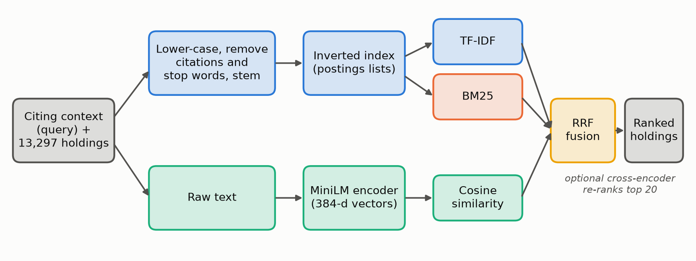
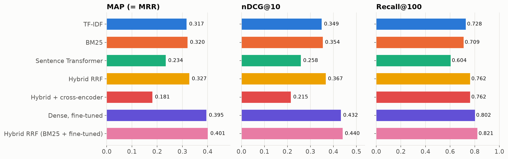
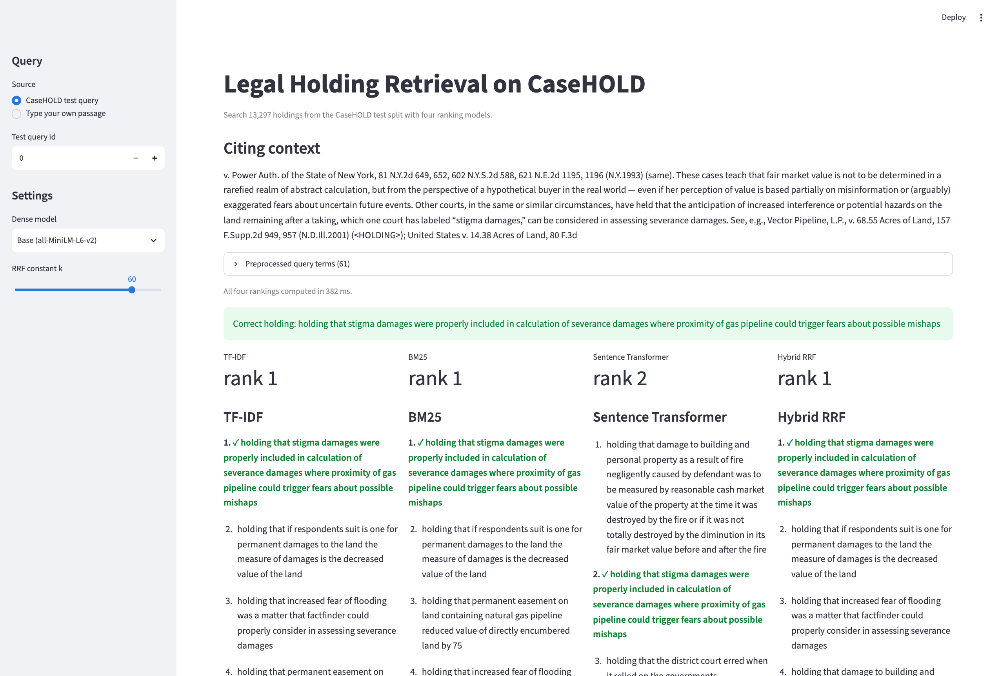

# Legal Holding Retrieval on CaseHOLD

Course project for **CSE4144 Information Retrieval**, B.Tech CSE, Manipal University Jaipur (2026-27).
Sarim Khan (23F10CSE00486). Guide: Ms Shweta Sharma.

Given a passage from a US court decision that cites a case, find the **holding** of the cited case.
We recast the [CaseHOLD](https://arxiv.org/abs/2104.08671) dataset as a retrieval task, where the citing
passage is the query and every holding in the test split is a document (3,600 queries,
13,297 holdings), and compare:

| Model | What it is |
|---|---|
| TF-IDF | Vector space model, (1 + log tf) x idf, cosine similarity |
| BM25 | Okapi BM25 written on our own inverted index |
| Sentence Transformer | `all-MiniLM-L6-v2` dense retrieval |
| Hybrid RRF | Reciprocal Rank Fusion of the three lists above |
| Ext. 1 | MiniLM fine-tuned for 1 epoch on the 45,000 CaseHOLD training pairs |
| Ext. 2 | `ms-marco-MiniLM-L6-v2` cross-encoder re-ranking the hybrid top 20 |



## Results (test split)

### Full-pool retrieval (test split)

| Ranking model | P@10 | Recall@10 | Recall@100 | MAP (= MRR) | nDCG@10 | Wilcoxon p vs BM25 |
|---|---|---|---|---|---|---|
| TF-IDF | 0.049 | 0.488 | 0.728 | 0.317 | 0.349 | 0.41 |
| BM25 | 0.049 | 0.492 | 0.709 | 0.320 | 0.354 | - |
| Sentence Transformer | 0.037 | 0.369 | 0.604 | 0.234 | 0.258 | 1e-65 |
| Hybrid RRF (TF-IDF + BM25 + Dense) | 0.053 | 0.526 | 0.762 | 0.327 | 0.367 | 3.2e-16 |
| Hybrid RRF, k = 5 | 0.054 | 0.535 | 0.759 | 0.341 | 0.380 | 7.8e-21 |
| Hybrid RRF (BM25 + Dense) | 0.049 | 0.488 | 0.747 | 0.314 | 0.347 | 0.63 |
| Hybrid + cross-encoder | 0.039 | 0.392 | 0.762 | 0.181 | 0.215 | 5e-66 |
| Dense, fine-tuned (ext.) | 0.058 | 0.581 | 0.802 | 0.395 | 0.432 | 1.9e-45 |
| Hybrid RRF (BM25 + fine-tuned Dense) | 0.060 | 0.596 | 0.821 | 0.401 | 0.440 | 4.3e-162 |

### 5-choice setting (original CaseHOLD format)

| Ranking model | Accuracy | MRR | Recall@2 | nDCG@5 |
|---|---|---|---|---|
| TF-IDF | 0.554 | 0.726 | 0.764 | 0.795 |
| BM25 | 0.579 | 0.745 | 0.788 | 0.809 |
| Sentence Transformer | 0.523 | 0.705 | 0.738 | 0.779 |
| Dense, fine-tuned (ext.) | 0.637 | 0.785 | 0.842 | 0.839 |
| Hybrid RRF (TF-IDF + BM25 + Dense) | 0.584 | 0.746 | 0.784 | 0.810 |
| Hybrid RRF (BM25 + Dense) | 0.563 | 0.736 | 0.787 | 0.803 |
| Hybrid RRF (BM25 + fine-tuned Dense) | 0.624 | 0.777 | 0.834 | 0.833 |
| Cross-encoder (ms-marco) | 0.386 | 0.605 | 0.611 | 0.703 |



Main findings: BM25 is the strongest required single model; RRF raises Recall@100 more than MAP;
fine-tuning the dense model on CaseHOLD training pairs gives the largest gain, and BM25 + fine-tuned
dense is the best run. The web-trained cross-encoder hurts.

## Project layout

```
casehold_ir/            library code
  data.py               load CaseHOLD (LexGLUE) and build the retrieval pool + relevance labels
  preprocess.py         tokenizer: lower-case, drop citations/digits, stop words, Porter stemming
  index.py              inverted index (postings lists) and BM25 (loop and matrix versions)
  models.py             TF-IDF, dense model, top-k, Reciprocal Rank Fusion, cross-encoder re-ranking
  metrics.py            P@k, Recall@k, MAP (= MRR), nDCG, Precision-Recall curve
  plotting.py           shared figure style
scripts/
  explore_data.py       Table 1, Figure 1 (lengths), Figure 2 (pipeline)
  tune_validation.py    choose every parameter on the validation split -> results/validation.json
  finetune_dense.py     Extension 1: fine-tune MiniLM on the training split -> models/
  evaluate.py           all test runs, tables, figures, Wilcoxon tests, error analysis -> results/
app/search_app.py       Streamlit demo comparing the four rankers side by side
slides/build_slides.py  builds the presentation from the result files
results/                every number and figure used in the report and slides
```

## How to run

Tested with Python 3.12 on an Apple M2 Pro (32 GB). Neural models use the Apple GPU (MPS) or CUDA if available, otherwise CPU.

```bash
git clone https://github.com/sarimkhan-sketch/casehold-legal-retrieval.git
cd casehold-legal-retrieval
python3 -m venv .venv && source .venv/bin/activate
pip install -r requirements.txt && pip install -e .

python scripts/explore_data.py      # dataset statistics and figures 1-2   (~1 min)
python scripts/tune_validation.py   # parameter selection on validation    (~3 min)
python scripts/finetune_dense.py    # optional extension, ~10 min on M2 Pro GPU
python scripts/evaluate.py          # all test results                     (~5 min, cross-encoder is the slow part)
python slides/build_slides.py       # rebuild the PowerPoint from results/
```

The dataset (`coastalcph/lex_glue`, config `case_hold`) and the pretrained models download automatically
from Hugging Face on first run. The fine-tuned model is not stored in the repo (about 90 MB); `finetune_dense.py` recreates it.

## Demo

```bash
streamlit run app/search_app.py
```

Opens on http://localhost:8501 (bound to this machine only). Pick a CaseHOLD test query or type your own passage. The app
shows the preprocessed query terms, the top 10 from TF-IDF, BM25, the dense model (base or fine-tuned)
and RRF, and marks the correct holding with its rank in each list. BM25 answers single queries by walking the postings
lists directly.



## Timings (one run, M2 Pro)

Index build: TF-IDF 0.21 s, BM25 0.15 s. Scoring all 3,600 queries: TF-IDF 0.57 s, BM25 0.42 s.
Dense encoding of queries and holdings: 10.4 s. Cross-encoder re-ranking: 185 s.

## References

1. Robertson & Zaragoza. The Probabilistic Relevance Framework: BM25 and Beyond. FnTIR, 2009.
2. Reimers & Gurevych. Sentence-BERT. EMNLP-IJCNLP, 2019.
3. Cormack, Clarke & Buettcher. Reciprocal Rank Fusion outperforms Condorcet and individual Rank Learning Methods. SIGIR, 2009.
4. Zheng et al. When Does Pretraining Help? Assessing Self-Supervised Learning for Law and the CaseHOLD Dataset. ICAIL, 2021.
5. Chalkidis et al. LexGLUE: A Benchmark Dataset for Legal Language Understanding in English. ACL, 2022.
6. Manning, Raghavan & Schütze. Introduction to Information Retrieval. Cambridge University Press, 2008.
